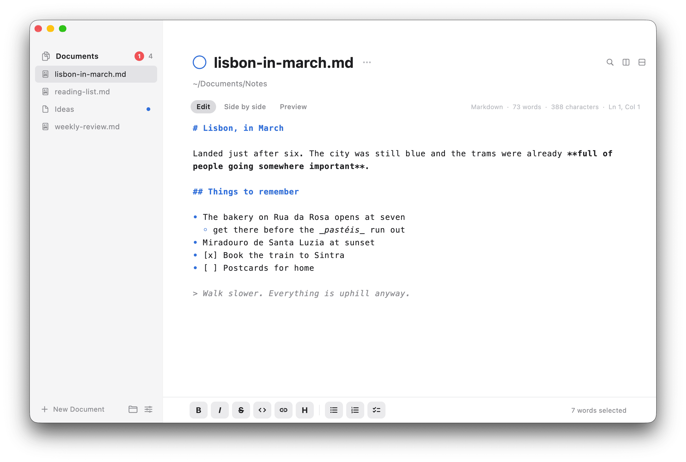
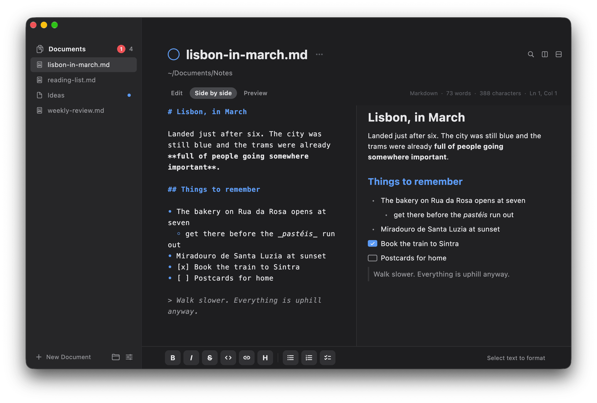
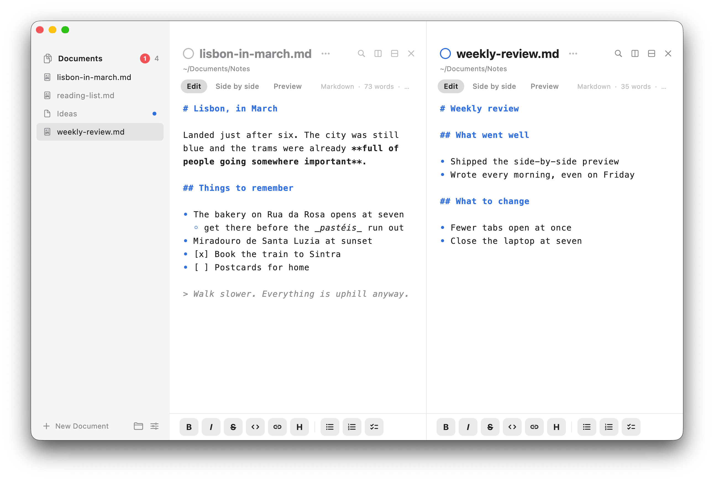
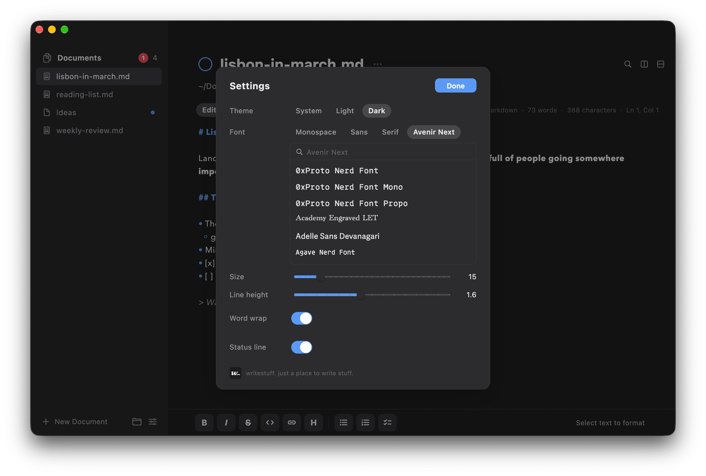

<p align="center">
  <picture>
    <source media="(prefers-color-scheme: dark)" srcset="assets/branding/icon-light.png">
    
  </picture>
</p>

<h1 align="center">writestuff</h1>

<p align="center"><em>just a place to write stuff.</em></p>

<p align="center">
  <picture>
    <source media="(prefers-color-scheme: dark)" srcset="assets/screenshots/hero-dark.png">
    
  </picture>
</p>

A quiet desktop editor for plain text and Markdown. All your documents sit in one
sidebar, and the canvas leaves you alone to write. There are no accounts and no
sync, and nothing ever leaves your computer.

## Write and see it at once

Every pane can show the **Edit** view, a **Side by side** view with a live preview,
or the rendered **Preview**. Headings, emphasis, lists, quotes and code are
highlighted as you type. Checklists become real checkboxes in the preview.



## Formatting, always in reach

The bar under the editor puts bold, italic, strikethrough, code, links, headings
and lists one click away. They wrap the selection, or the word under the cursor,
and clicking again removes the formatting. Lists continue when you press Enter,
nest with Tab and un-nest with Shift+Tab.

## Many documents, side by side

Split any pane right or down, up to eight panes at a time. Drag the dividers to
resize them, and drag a header to move a pane somewhere else. Each pane keeps its
own cursor, even when two panes show the same document.



## Make it yours

Use a light theme, a dark one, or follow the system. Write in monospace, sans or
serif, or in **any font installed on your computer**, from a searchable list
that shows each font in its own face. Text size, line height, word wrap and the
status line are all adjustable.



## Never lose a word

- Unsaved documents, even ones you never named, survive quitting, restarting
  and crashes. Everything comes back exactly as you left it.
- Saves are atomic: the old file is only replaced once the new one is safely
  written, and file permissions are kept.
- If a file changed on disk since you opened it, writestuff won't overwrite it.
  Save a copy with Save as instead.
- Closing a document or quitting with unsaved changes always asks first.
- Click a title to rename it. For a saved document, that renames the file on
  disk.

## Shortcuts

Use **Cmd** on macOS and **Ctrl** on Windows and Linux.

| | |
| --- | --- |
| New document | Cmd N |
| Open / Save / Save as | Cmd O / Cmd S / Cmd ⇧ S |
| Close document / Close pane | Cmd W / Cmd ⇧ W |
| Split right / Split down | Cmd D / Cmd ⇧ D |
| Preview / Side by side | Cmd P / Cmd ⇧ P |
| Find and replace | Cmd F |
| Bold / Italic / Strikethrough | Cmd B / Cmd I / Cmd ⇧ X |
| Code / Link | Cmd E / Cmd K |
| Bulleted / Numbered / Checklist | Cmd ⇧ 8 / Cmd ⇧ 7 / Cmd ⇧ 9 |
| Nest / un-nest list items | Tab / ⇧ Tab |
| Bigger / smaller text | Cmd + / Cmd − |
| Undo / Redo | Cmd Z / Cmd ⇧ Z |
| Settings | Cmd , |

## Install on macOS

```sh
./install.sh
```

Quit writestuff first. Your documents are restored on the next launch.
